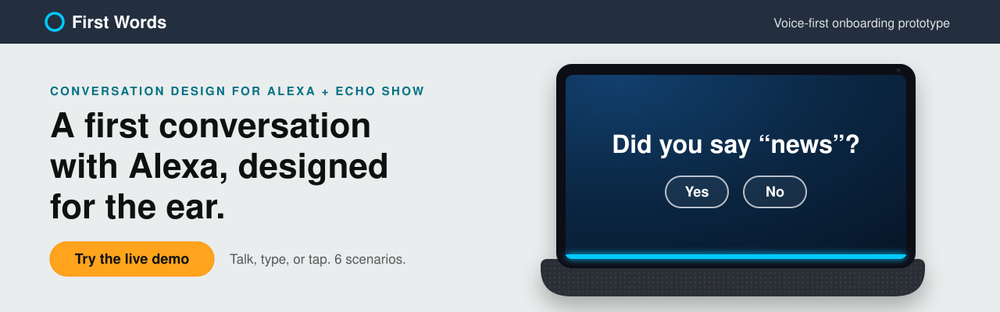
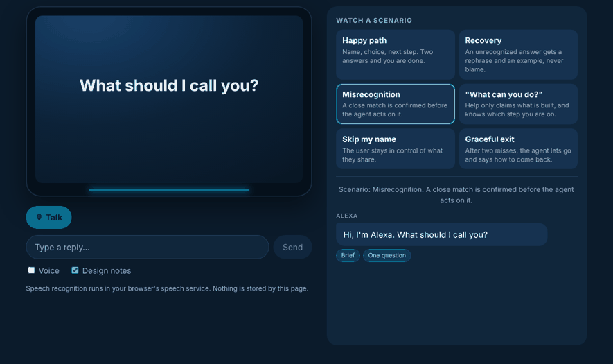

<p align="center"></p>

<p align="center">
  <a href="https://github.com/jkelleman/alexa-prototype/actions/workflows/ci.yml"></a>
  <a href="https://jkelleman.github.io/alexa-prototype/"></a>
  
  
  
  
</p>

# First Words

**A voice-first onboarding prototype.** A new user meets Alexa, shares a name (or skips it), picks what they want first, and leaves knowing exactly what to say next. An Echo Show–style screen follows along.

**[Try the live demo →](https://jkelleman.github.io/alexa-prototype/)** Talk, type, or tap. Or watch one of six scenarios, with a design note on every turn.

<p align="center"></p>

## Problem

First-run setup is usually screen-driven. On a voice device, users abandon long menus and can't tell what the assistant can do. Goal: get a new user to a first successful task in under a minute, by voice alone.

## Principles

1. One question per turn.
2. Ground every answer in what the user said or in known data; never invent.
3. Recover from silence and misrecognition without blame.
4. The screen supports the voice; it never carries information the voice lacks.

The tests in `skill/lambda/test.js` check these directly: every open turn asks one question, each reprompt uses new wording, help never claims a capability that isn't built, and the screen never offers a choice the voice didn't say.

## How it's built

One dialog engine, two surfaces.

```
                skill/lambda/dialog.js
         (copy, recovery rules, screen content)
               ▲                       ▲
   skill/lambda/index.js          app.js (web demo)
   Alexa intents → events         typed, spoken, or tapped input → events
   + APL screen on Echo Show      + smart-display screen + design notes
```

Because both surfaces call the same `next(state, event)` function, the demo shows exactly what the skill would say. `design/transcripts.md` is generated from the engine too, so the docs can't drift either.

## Conversation design decisions

| Decision | Alternative | Tradeoff |
|---|---|---|
| Ask name first, with a way to skip | Skip personalization | Warmer, but one more turn before value. Skipping keeps the user in control of what they share. |
| Offer 3 choices (music, news, smart home) | Open-ended "what do you want?" | Faster to answer, narrower discovery |
| Two reprompts on unrecognized input, then exit gracefully | Loop until answered | Less frustrating, may lose some users. Silence gets Alexa's single built-in reprompt. |
| Confirm a close match ("Did you say news?") | Act on the best guess | One extra turn, but the user never ends up somewhere they didn't ask for |
| End with a specific next step ("Try saying, 'Alexa, play some jazz.'") | End with "That's all for now" | The user leaves knowing what to say |
| Help depends on the step you're on | One help message | Help asked during the name step still asks for the name |
| Screen mirrors speech | Rich screen-only content | Works on devices without a screen |

## Scenarios

| Scenario | What it shows |
|---|---|
| Happy path | Name, choice, next step |
| Recovery | An unrecognized answer gets a rephrase and an example, never blame |
| Misrecognition | "neus" → "Did you say news?" |
| "What can you do?" | Help only claims what's built |
| Skip my name | The user decides what to share |
| Graceful exit | After two misses, the agent lets go and says how to come back |

Read them all in [`design/transcripts.md`](design/transcripts.md), or play them in the [demo](https://jkelleman.github.io/alexa-prototype/).

## Run it

```bash
# Web demo (any static server works)
python3 -m http.server 8000      # then open http://localhost:8000

# Skill tests and transcripts
cd skill/lambda
npm install
npm test                         # engine + skill tests
npm run transcripts              # regenerate design/transcripts.md
```

**Embed the demo** (for a portfolio page):

```html
<iframe src="https://jkelleman.github.io/alexa-prototype/?embed=1"
        title="First Words voice onboarding demo"
        width="100%" height="760" allow="microphone" loading="lazy"></iframe>
```

`?embed=1` hides the page header. `?play=misrecognition` starts a scenario on load with the voice off. Add `&steps=2` to stop partway so the visitor can take over.

## Repo layout

- `index.html`, `app.js`, `style.css`: web demo (GitHub Pages)
- `skill/lambda/dialog.js`: the shared dialog engine
- `skill/lambda/index.js`: Alexa skill handler (ASK SDK v2), maps intents to engine events, sends the APL screen
- `skill/lambda/apl/screen.json`: APL screen template, filled from the engine's screen data
- `skill/interactionModels/custom/en-US.json`: invocation `first words`, intents, synonyms
- `design/`: annotated dialogs, generated transcripts, flow diagram, walkthrough script
- `eval/rubric.md`, `prompts/persona.md`
- `multimodal/`: screen notes and mockup

## Status (honest)

- The skill passes local tests but **has not been deployed or tested in the Alexa Developer Console**.
- The APL screen is wired into the skill but **has not been tested in the simulator or on a device**.
- Dialog scores in `design/dialogs.md` are **self-scored**, not from user research.
- The web demo's speech recognition uses the browser's speech service (best in Chrome, Edge, and Safari). Names come from a short list; say "call me ___" for any name. On Alexa, `AMAZON.FirstName` does this job.

_Independent portfolio project. Not affiliated with or endorsed by Amazon._
